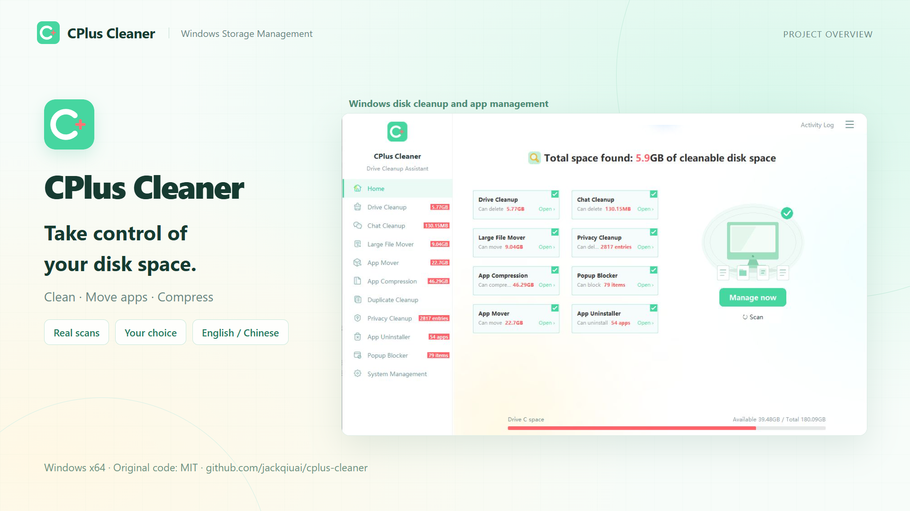
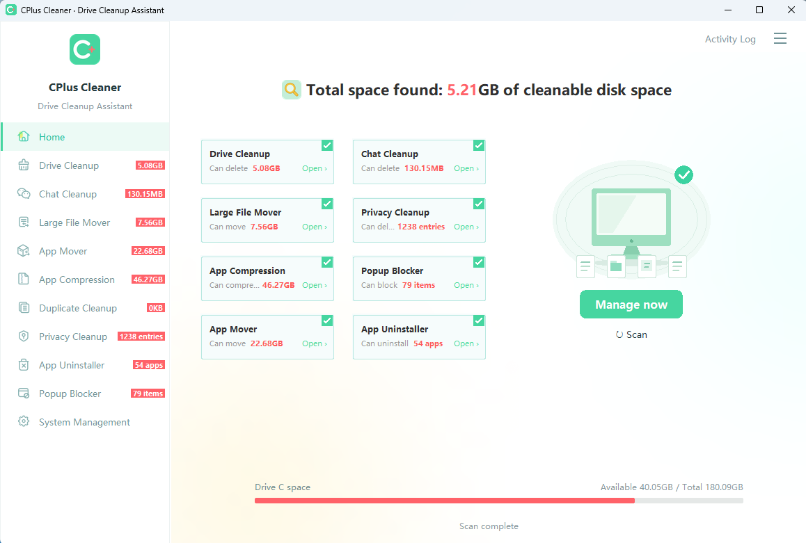

# CPlus Cleaner — Windows Disk Cleaner & App Mover

**Free up disk space and manage installed applications.**

**English** · [简体中文](README.zh-CN.md) · [Report an issue](https://github.com/jackqiuai/cplus-cleaner/issues) · [Contributing](CONTRIBUTING.md) · [MIT License](LICENSE)

CPlus Cleaner is a Windows desktop utility for disk cleanup, application migration, NTFS compression and privacy cleanup. It combines chat cache cleanup, large-file management, duplicate detection, software uninstall and rule-based popup blocking in a Chinese/English interface.

**Project status:** Complete Python source, images, rules and language resources are included. Windows x64 EXE builds are configured in [GitHub Actions](https://github.com/jackqiuai/cplus-cleaner/actions/workflows/build-windows.yml). Successful runs provide executable artifacts; published GitHub Releases receive the EXE, portable ZIP and checksums. See [Build instructions](docs/BUILDING.md).

## Introduction video

[](https://github.com/jackqiuai/cplus-cleaner/raw/refs/heads/main/docs/videos/CPlus-Cleaner-intro-en.mp4)

**[Watch or download the English video (MP4)](https://github.com/jackqiuai/cplus-cleaner/raw/refs/heads/main/docs/videos/CPlus-Cleaner-intro-en.mp4)**

*80 seconds · 1080p · English interface screenshots, English synthesized narration and subtitles. Covers scanning, Drive Cleanup, App Mover, Large File Mover, App Compression and more. Personal paths are hidden; scan results vary by computer.*

## Screenshot



*Home dashboard after a scan. Results vary with the computer and installed applications.*

## Features

| Feature | What it does |
| --- | --- |
| Home scan | Scan selected features, show progress and reuse results when opening a feature page. |
| Drive Cleanup | Summarize supported temporary files, caches, logs and application leftovers by category and size. Scan all time or the last 7, 30 or 180 days. |
| Chat Cleanup | Find supported cache and attachment locations for WeChat, QQ, WhatsApp, Telegram, Discord, Slack, Microsoft Teams and Signal. Coverage depends on the installed client and its data layout. |
| Large File Mover | Group files larger than 30 MiB by type. Expand a category to select, move or delete individual files or the category's files. |
| App Mover | Move eligible applications to another NTFS volume, verify copied contents and preserve the original path through a Windows directory junction. Applications containing system services are excluded. |
| App Compression | Compress eligible installations using Windows transparent compression and restore supported files from compression history. Protected installations are excluded. |
| Duplicate Cleanup | Match full file contents with SHA-256 and keep at least one copy in each group. |
| Privacy Cleanup | Review supported Windows usage traces, application traces, Chrome/Edge history and derived privacy categories. |
| Software Uninstall | Search installed applications, select individual or multiple entries and invoke their registered uninstallers. Review supported leftovers after uninstalling. |
| Popup Blocker | Detect supported applications and manage group and individual popup rules. Unsupported rules are omitted from the list. |
| System Management | Inspect system files and access recycle-bin, hibernation, virtual-memory and Windows component-store actions. |

Additional settings include daily scheduled cleanup, startup with Windows, close-to-tray behavior and a persistent language choice. Operation history opens in a separate window.

## Download the Windows EXE

Download `CPlusCleaner.exe` or the portable ZIP from [Releases](https://github.com/jackqiuai/cplus-cleaner/releases) when a version is published. For the latest commit build, open a successful [Actions run](https://github.com/jackqiuai/cplus-cleaner/actions/workflows/build-windows.yml) and download `CPlusCleaner-windows-x64`. The packaged Windows x64 application does not require Python.

## Requirements

- Windows desktop environment; intended for Windows 10 and Windows 11.
- When running from source: Python 3.10 or newer with Tkinter. Automated EXE builds and regression tests use Python 3.13.
- No third-party Python packages are required at runtime.
- Application migration requires different source/destination NTFS volumes; compression requires NTFS support.
- Some protected locations and Windows maintenance actions require administrator permission. Read-only component analysis can request Windows UAC approval.

## Run from source

Keep the complete source tree together, including `app.py`, `start.bat`, `cplus_cleaner/`, `assets/`, `rules/` and `locales/`. See [Source layout](docs/SOURCE_LAYOUT.md) for resource paths and publication checks.

1. Install Python with **Tcl/Tk and IDLE** enabled.
2. Clone this repository or download its source ZIP, then open the directory containing `app.py`.
3. Double-click `start.bat`, or run:

```powershell
python app.py
```

Repeated launches restore the existing window instead of opening another instance. After replacing source files, fully exit the old process before starting the updated application.

To check the source files and resource inventory without scanning or changing user files:

```powershell
python tools/verify_source_tree.py
```


Python code is organized under `cplus_cleaner/` by feature and shared responsibility. The root keeps only `app.py` as its Python launcher. See the [module purpose guide](docs/MODULES.md) and [image/rule resource guide](assets/README.md).

## Typical workflow

1. On **Home**, select features and click **Scan**, or open an individual feature page.
2. Review category sizes, record counts and selected items.
3. Uncheck items you want to retain, then choose **Delete**, **Move**, **Compress** or **Uninstall** as appropriate.
4. Review the outcome and operation history. Migration and compression maintain separate recovery records.

Drive and chat cleanup summarize categories rather than listing every file. Large File Mover and Duplicate Cleanup expose individual file selections.

## Behavior to understand before cleaning

- **Delete permanently removes selected files; it does not send them to the Recycle Bin.** Scan and review selections before deleting.
- Chat Cleanup automatically selects supported categories with non-zero size after scanning. Some WeChat/QQ categories include received files and media, not just disposable caches.
- Privacy Cleanup can remove selected history records. It does not delete the corresponding downloaded documents or claim to erase all traces of activity.
- Scheduled cleanup first runs a fresh all-time Drive Cleanup scan, then deletes the default ordinary categories. It runs only while the application is open or in the tray; closing the process stops scheduling.
- Virtual memory, hibernation, the Recycle Bin and the component store are managed separately from ordinary cleanup totals.
- File operations recheck supported paths and file identities. Changes, access errors, active applications and unsupported data layouts can cause items to be skipped.
- File-size totals are logical sizes; they are not a guarantee of physical space reclaimed. Migration capacity and compression candidates are not added to the ordinary garbage total.
- Recovery history is not a backup of file contents. Applications may update or modify files after an operation.

## Language and local data

On first launch, a Chinese Windows display language selects Chinese; other display languages select English. Change the language in **Settings → Language**. Software names, file paths and Windows-returned output retain their original values where appropriate.

The program stores settings, history and recovery manifests under:

```text
%LOCALAPPDATA%\CCLEANNER\
```

The internal directory name is retained for compatibility. Cleaning works locally without an account or cloud service. Opening a feedback link uses your browser; no diagnostic report is uploaded automatically. File-operation logs may contain local paths.

## Feedback and contributions

Use [GitHub Issues](https://github.com/jackqiuai/cplus-cleaner/issues) for reproducible problems and feature requests. Include the application version, Windows version, affected feature, reproduction steps, expected behavior and actual result. Redact personal paths and account information from screenshots and logs.

For development and test expectations, see [CONTRIBUTING.md](CONTRIBUTING.md). Run the included Windows regression suite with `python -m unittest discover -s tests -v`.

## Project status

The current application version is **1.1.0**. Windows x64 builds are available through successful Actions runs. A GitHub Release is published separately; publishing it triggers attachment of the verified binaries. An installer is not generated.

## License

The original project code and documentation are licensed under the [MIT License](LICENSE). You may use, modify and distribute them free of charge, including for commercial purposes, provided that the copyright and permission notices are retained. The software is provided "AS IS", without warranty; see the license for the complete terms.

Third-party artwork, rule data and software names retain their applicable rights and are not automatically licensed under MIT by this project. Preserve their provenance and follow their original distribution terms; see the [resource guide](assets/README.md) and accompanying source records. The project is independent and is not affiliated with Microsoft, Tencent, Huorong or the other software vendors named above.

<!-- Purpose: Project overview, features and source launch instructions -->
