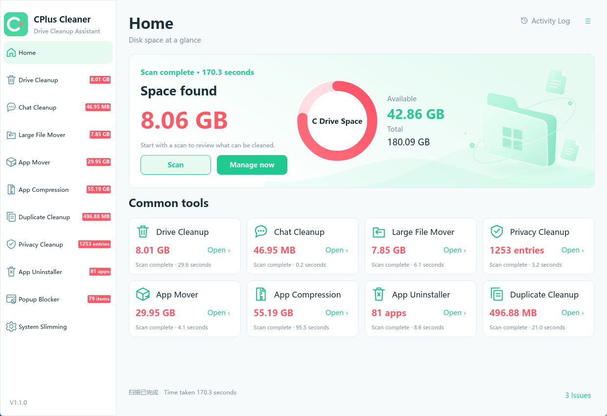

# CPlus Cleaner — Windows Disk Cleanup & App Migration

**Free up disk space and manage installed applications.**

**English** · [简体中文](README.zh-CN.md) · [繁體中文](README.zh-TW.md) · [Feedback](https://github.com/jackqiuai/cplus-cleaner/issues) · [MIT License](LICENSE)

CPlus Cleaner is a free, portable Windows desktop utility for disk cleanup, large-file migration, application migration, transparent compression and privacy cleanup. It is built with **Rust + Iced**, with Simplified Chinese, Traditional Chinese and English interfaces.

**Portable, no installation required.** Images, rules and translations are embedded in the executable.

## Screenshot



## Features

| Feature | What it does |
| --- | --- |
| Home | View system-drive space, run a combined scan and open individual tools. |
| Drive Cleanup | Review temporary files, caches, logs and system-related categories across all time or the last 7, 30 or 180 days. Ordinary files use logical sizes; supported Windows cleanup handlers report Delivery Optimization, Windows Update and previous-installation capacity. |
| Chat Cleanup | Scan supported cache and media locations for WeChat, QQ, WhatsApp, Telegram, Discord, Slack, Teams and Signal. Coverage depends on the client version and data layout. |
| Large-file migration | Group files larger than 30 MiB by type for selection, deletion or migration. System components and font files are excluded by the protection rules. |
| Application migration | Discover registered applications, check eligible installations and migrate them to another NTFS volume. Verified copies and a directory junction preserve the original application path. |
| App Compression | Use Windows transparent compression for eligible installations, report actual disk usage and maintain compression/restoration history. |
| Duplicate Cleanup | Verify identical contents with SHA-256, retain at least one copy per group and display results by type, duplicate group and file. Supports expand/collapse all. |
| Privacy Cleanup | Review supported Windows traces, application traces and browser history. |
| Software Uninstall | List registered applications, invoke their uninstallers and separately review supported leftovers. |
| Popup Blocker | Discover applications supported by the bundled rules and manage group/individual switches and blocking history. |
| System Slimming | Access recycle-bin, hibernation, virtual-memory and Windows component-store tools. |
| Taskbar system status | Show CPU usage, memory usage, system-drive space usage and upload/download speeds on the right side of the taskbar. Click a metric to open its detail page. |

Settings include automatic language switching and saving, startup with Windows, daily cleanup and close-to-tray behavior. Separate windows provide activity records, feature histories, feedback, About and update checking.

### Taskbar system status

Enable **Settings → System status** to show a compact taskbar panel. CPU, MEM and DISK show usage percentages; **↑ / ↓** show upload and download speeds in the same column. DISK means system-drive space usage.

Click a metric to open **Overview, CPU, Memory, Disk or Network**. CPU and Memory list the processes using the most resources. Disk shows system-drive capacity and read/write activity. Network shows live speeds, traffic counted during monitoring, the interface, connected WLAN name, connection status, link speed, IPv4 and IPv6. Unavailable values appear as `--`.

The compact Network page displays its information without scrolling. Closing the detail window leaves monitoring running; turn off **System status** in Settings to disable it. Monitoring reads system counters and does not save traffic history.

## Download and run

The project repository is [jackqiuai/cplus-cleaner](https://github.com/jackqiuai/cplus-cleaner). Download published packages from [Releases](https://github.com/jackqiuai/cplus-cleaner/releases) and see the release notes for changes and usage information.

| File | Usage |
| --- | --- |
| `CPlusCleaner.exe` | Run the portable application directly. |
| `CPlusCleaner-windows-x64.zip` | Extract the bundle, then run `CPlusCleaner.exe`. |
| `SHA256SUMS.txt` | Verify the EXE or ZIP against the published SHA-256 digest. |
| Source archive | For development; the Rust source tree contains `Cargo.toml`, `crates/` and `resources/`. |

In a local build, the ready-to-run executable is `dist/CPlusCleaner.exe`. Repeated launches activate the existing instance.

## Requirements

- Windows 10/11 x64 desktop environment.
- Application migration requires suitable source and destination NTFS volumes; transparent compression requires NTFS support.
- Some protected locations, uninstallers and Windows maintenance operations require administrator permission.

## Typical workflow

1. Run a Home scan or scan an individual feature.
2. Review category sizes, file lists, status messages and selected items.
3. Choose cleanup, migration, compression or uninstall, then review the confirmation and result.
4. Use the corresponding history page for supported application restoration.

Settings save automatically; selecting a language takes effect immediately. Left-click the tray icon to show the main window. Right-click it for cleanup shortcuts, **Settings** and **Exit**.

## Before cleaning or moving files

- **Deletion is permanent and does not use the Recycle Bin.** Chat media and received files can include data you want to keep.
- Ordinary Drive Cleanup totals are logical sizes, not guaranteed physical space reclaimed. Locked, changed or inaccessible files may be skipped.
- Removing previous Windows installations prevents rolling back to that Windows version.
- Application migration excludes protected/shared installations, system-service applications, linked or unsupported paths and detected environment-variable dependencies. Close applications before migration or restoration.
- Compression may slow application startup. If another drive has room, consider application migration first. Migration frees space on the source drive without reducing total usage across drives.
- Restore supported application moves or compression through their history pages. Keep both recovery records and the actual application files; records are not content backups. Clearing the activity log does not restore files.

### Scheduled cleanup

The application uses Windows Task Scheduler to register `CPlusCleaner-DailyCleanup`. The task can launch cleanup after the main application has exited, subject to Windows task conditions; it is configured for an interactive logged-on user. It scans all-time Drive Cleanup categories afresh and processes the eligible defaults. Previous Windows installations and Windows Update cleanup are explicitly excluded from this unattended selection. Keep the EXE at its registered location; changing the application path requires reconfiguring the task.

## Build from source

Open the **Rust source directory containing `Cargo.toml`**. Install Rust/rustup, Visual Studio C++ Build Tools and a Windows SDK. The checked-in `rust-toolchain.toml` pins Rust **1.99.1** with the `x86_64-pc-windows-msvc` target; keep `Cargo.lock` for reproducible dependency resolution. The first build needs network access for dependencies.

From the repository root in PowerShell:

```powershell
.\build.ps1
```

The script runs the regression suite, creates a release build and packages the EXE, portable ZIP and checksums under `dist/`. To build only the executable:

```powershell
cargo build --release --locked -p cplus-cleaner
.\target\release\CPlusCleaner.exe
```

Development checks:

```powershell
cargo fmt --all --check
cargo clippy --workspace --all-targets --locked -- -D warnings
cargo test --workspace --locked
```

Some Windows tests create temporary hard links, junctions, sparse or compressed files and need suitable filesystem permissions. Code signing is optional; a local build is not automatically signed. See [signing configuration](docs/CODE_SIGNING.md).

## Source layout

| Path | Responsibility |
| --- | --- |
| `crates/desktop` | Iced interface, language selection, windows and tray integration |
| `crates/core` | Feature engines, cleanup rules, operation validation, settings and records |
| `crates/platform_windows` | Windows filesystem, registry, process and shell APIs |
| `resources` | Embedded images, rules and language files; see [resource notes](resources/assets/README.md) |
| `docs` | [Migration notes](docs/MIGRATION.md), [validation records](docs/VALIDATION.md) and signing information |
| `build.ps1` / `package.ps1` | Local build and packaging |
| `.github/workflows` | Windows build, optional signing and release-asset workflows |

Detailed [file and directory purposes](docs/SOURCE_MAP.md) · [clean-clone build and CI guide](docs/BUILDING.md).

## Language and local data

Choose **简体中文 / 繁體中文 / English** in Settings. The application initially selects a language based on Windows preferences. Settings and operation/recovery records are stored at:

```text
%LOCALAPPDATA%\CPLUSCLEANER\
```

For a separate development profile:

```powershell
.\dist\CPlusCleaner.exe --preview --language en --data-dir D:\CPlusCleaner-TestData
```

Preview mode isolates settings and disables startup/task registration, the popup worker and system-maintenance changes. **It is not a filesystem sandbox:** file actions must still use disposable test data.

## Frequently asked questions

<details>
<summary>Why is the original application directory still present after migration?</summary>

It is a Windows directory junction pointing to the destination. Keep the destination intact and use migration history for supported restoration.
</details>

<details>
<summary>Why are some applications absent from migration or compression lists?</summary>

The tools list registered applications and apply eligibility/protection checks. Unsupported directories, links, system components, running applications or access restrictions can exclude or disable an entry.
</details>

<details>
<summary>Why does the close button leave the application running?</summary>

When close-to-tray is enabled, closing the main window hides it. Use the tray menu's Exit command to quit fully; let active operations finish first.
</details>

## Update or remove

Use **≡ → Check for updates** to check for updates on GitHub. Downloading and replacing the EXE are manual steps; read the release notes first. Fully exit the old process before replacement and preserve recovery data. If moving the EXE, disable startup and scheduled cleanup first, then configure them again from the new location. Settings save automatically.

To remove the portable application, disable startup and scheduled cleanup, finish active operations and exit from the tray menu. Remove the application's own files. Retain `%LOCALAPPDATA%\CPLUSCLEANER\` and migrated application folders for as long as you need restoration. Removing Cleaner does not undo migrations/compression or recover deleted files.

## Feedback and support

Report reproducible problems or suggestions through [GitHub Issues](https://github.com/jackqiuai/cplus-cleaner/issues). Include the Windows version and steps to reproduce; redact personal paths and account data. The feedback window can copy environment information and open the issue page; submission remains under your control.

You can support development through **Donate** in the application, [Buy me a coffee](https://ko-fi.com/qiujack), or a star on the [project repository](https://github.com/jackqiuai/cplus-cleaner).

## License

Original project code is distributed under the [MIT License](LICENSE). Third-party artwork and rule data retain their own rights and distribution terms; the project license does not relicense those materials. CPlus Cleaner is independent of the software vendors mentioned here.
