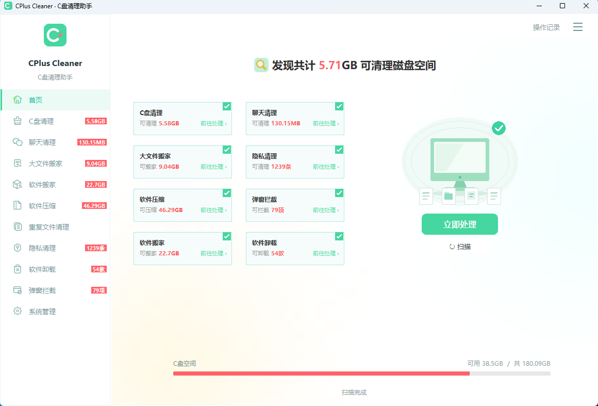
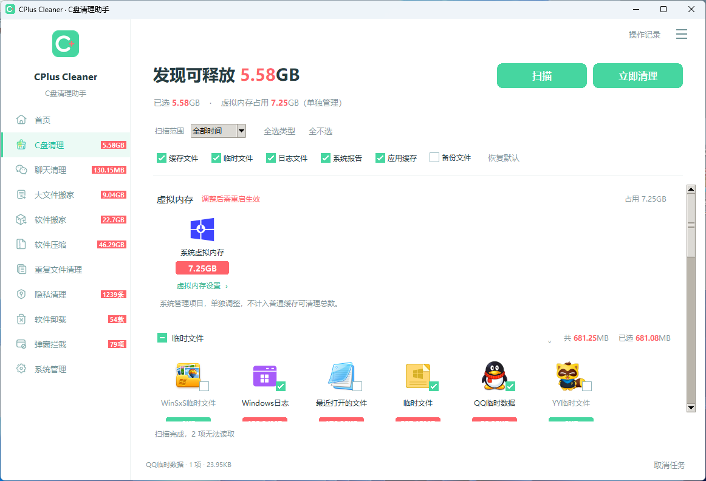
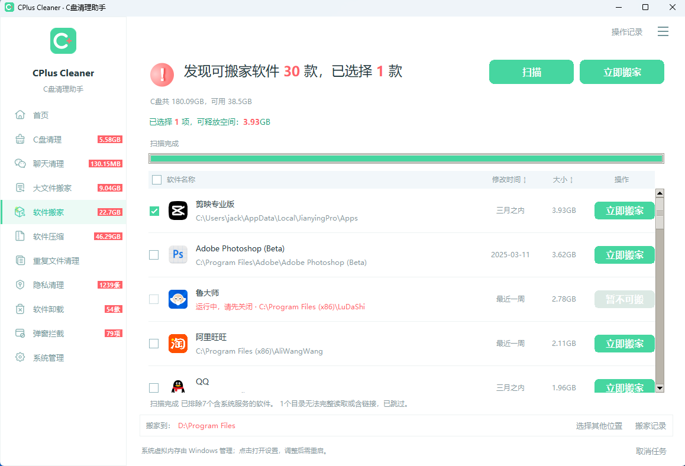

# CPlus Cleaner — Windows Disk Cleaner & App Mover｜C盘清理与软件搬家

**清理磁盘、搬移软件、整理聊天缓存，在一个中英文桌面界面中管理存储空间。**

**简体中文** · [English](README.md) · [问题反馈](https://github.com/jackqiuai/cplus-cleaner/issues) · [参与贡献](CONTRIBUTING.md) · [MIT 许可证](LICENSE)

CPlus Cleaner 是 Windows 桌面清理与空间管理工具，提供 C盘清理、软件搬家、软件压缩、聊天清理、隐私清理、大文件搬家、重复文件清理、软件卸载、弹窗拦截与系统管理。

**绿色版本，无需安装。** 下载 EXE 即可直接运行，也可解压便携 ZIP 后启动 `CPlusCleaner.exe`，无需另行安装 Python。

**项目状态：** 已包含完整 Python 源码、图片、清理规则及语言资源，并配置 [GitHub Actions 自动构建 Windows x64 EXE](https://github.com/jackqiuai/cplus-cleaner/actions/workflows/build-windows.yml)。构建成功后可下载产物，发布 GitHub Release 时会自动附加 EXE、便携 ZIP 和校验文件，详见[构建说明](docs/BUILDING.md)。

## 项目介绍视频

https://github.com/user-attachments/assets/c5228662-efab-49e4-b8d6-7b64b010f335

**[下载中文版原始视频（MP4）](https://github.com/jackqiuai/cplus-cleaner/raw/refs/heads/main/docs/videos/CPlus-Cleaner-intro-zh.mp4)**

*80 秒 · 1080p · 中文界面截图、中文合成旁白及字幕。介绍首页扫描、C盘清理、软件搬家、大文件搬家、软件压缩等功能。个人路径已遮挡，扫描结果随电脑环境变化。*

## 软件截图

以下为中文版实际界面截图，容量与扫描结果随电脑环境变化。

### 首页扫描结果



### C盘清理



### 软件搬家



## 功能一览

| 功能 | 说明 |
| --- | --- |
| 首页扫描 | 按勾选的功能依次扫描，显示进度、容量或条数；打开功能页时复用本轮结果。 |
| C盘清理 | 按类型汇总临时文件、缓存、日志及已支持的应用残留。默认扫描全部时间，可选择7天内、30天内、180天内。实际扫描 Windows 系统所在分区。 |
| 聊天清理 | 支持微信、QQ、WhatsApp、Telegram、Discord、Slack、Microsoft Teams、Signal 的已知缓存或附件目录。具体覆盖取决于客户端版本和数据布局。 |
| 大文件搬家 | 按文件类型扫描大于30 MiB的文件；展开类别后可对类别或单个文件搬家、删除。 |
| 软件搬家 | 将符合条件的软件搬到另一 NTFS 分区，复制后校验内容，并使用目录联接保留原路径。含系统服务的软件不列入。 |
| 软件压缩 | 调用 Windows 透明压缩能力处理符合条件的安装目录，可通过记录还原受支持的文件；排除受保护的软件。 |
| 重复文件清理 | 使用 SHA-256 比较完整内容，每组至少保留一份。 |
| 隐私清理 | 分类整理已支持的 Windows 使用痕迹、软件痕迹、Chrome/Edge 浏览和下载历史及派生隐私项目。 |
| 软件卸载 | 搜索、选择单个或多个已安装软件，调用其注册的发布者卸载程序；卸载后可检查受支持的残留。 |
| 弹窗拦截 | 识别已支持的软件，按组或单条规则设置拦截；列表不展示暂不支持的规则。 |
| 系统管理 | 查看系统文件占用，管理回收站、休眠、虚拟内存及 Windows 组件存储。 |

设置支持每日定时清理、开机自启动、关闭时隐藏到系统托盘和语言选择。操作记录使用独立窗口。

## 下载 Windows EXE

从 [Releases](https://github.com/jackqiuai/cplus-cleaner/releases) 下载 `CPlusCleaner.exe` 或 `CPlusCleaner-windows-x64.zip`。两者均为 **Windows x64 绿色便携版本，无需安装**：EXE 下载后直接运行，ZIP 解压后启动 `CPlusCleaner.exe`，无需额外安装 Python。需要最新提交的构建版本时，打开成功的 [Actions 构建记录](https://github.com/jackqiuai/cplus-cleaner/actions/workflows/build-windows.yml)，下载 `CPlusCleaner-windows-x64` 产物。

## 运行要求

- Windows 桌面环境，面向 Windows 10 / Windows 11。
- 从源码运行时需要 Python 3.10 或以上及 Tkinter；自动 EXE 构建和回归测试使用 Python 3.13。
- 运行时不需要额外安装第三方 Python 包。
- 软件搬家要求源、目标位于不同 NTFS 分区；软件压缩要求 NTFS 支持。
- 部分受保护目录及系统维护操作需要管理员权限；只读组件分析可请求 Windows UAC 授权。

## 从源码启动

请保留包含 `app.py`、`start.bat`、`cplus_cleaner/`、`assets/`、`rules/`、`locales/` 的**完整源码目录**，资源位置和发布检查见[源码目录说明](docs/SOURCE_LAYOUT.md)。

1. 安装 Python，保留 **Tcl/Tk and IDLE** 组件。
2. 克隆本仓库或下载源码 ZIP，打开 `app.py` 所在目录。
3. 双击 `start.bat`，或执行：

```powershell
python app.py
```

重复启动会唤起已有窗口，不会打开多个实例。更新源码后，应先完全退出旧进程，再启动新版本。

可以先执行以下命令核对源码和运行资源完整性；该检查不会扫描或处理用户文件：

```powershell
python tools/verify_source_tree.py
```


Python 源码按功能整理到 `cplus_cleaner/`，根目录仅保留 `app.py`。每个文件的用途见 [Python 模块说明](docs/MODULES.md)，图片和规则用途见[资源说明](assets/README.md)。

## 基本使用

1. 在首页勾选需要的功能并点击“扫描”，也可进入对应功能页单独扫描。
2. 查看各类型的占用或记录数量，检查默认勾选。
3. 取消不需要处理的项目，再执行“立即清理”“立即搬家”“压缩”或“卸载”。
4. 查看操作结果和操作记录；软件搬家、软件压缩另有专用恢复记录。

C盘和聊天清理按类型汇总，不逐个展示文件。大文件搬家与重复文件清理支持单个文件操作。

## 使用前需要了解

- **清理操作会永久删除所选文件，不经过回收站。** 请先扫描并检查选项。
- 聊天清理完成后，默认勾选有容量的已支持分类；微信/QQ 的部分分类包含接收文件和图片、视频等附件，不能全部视为无用缓存。
- 隐私清理可删除所选历史条目，不会据此删除对应的下载文件，也不保证擦除所有活动痕迹。
- 定时清理会先重新扫描全部时间范围的 C盘常规垃圾，再删除默认常规分类；软件必须运行或驻留托盘，完全退出后不执行。
- 虚拟内存、休眠、回收站和组件存储单独管理，不混入普通垃圾容量。
- 操作前会重新检查已支持的路径和文件身份。文件变化、权限不足、客户端仍在运行或数据布局不支持时，可能跳过对应项目。
- 容量主要按文件逻辑大小统计，不保证与磁盘实际释放空间相等。软件搬家、压缩容量不计入首页普通垃圾总量。
- 恢复记录不是文件内容备份；软件更新、目录替换或操作后的新数据会影响自动还原。

## 语言与本地数据

首次启动按 Windows 显示语言选择界面：中文系统使用中文，其他语言使用英文。可在“设置 → 语言”中改为“中文”或“English”。真实软件名称、文件路径及 Windows 返回的内容按对应规则保留原样。

设置、日志和恢复记录保存在：

```text
%LOCALAPPDATA%\CCLEANNER\
```

内部目录名为兼容已有数据而保留。清理在本地进行，不需要账号或云端服务；打开反馈链接会使用浏览器，不会自动上传诊断报告。文件操作日志可能包含本地路径。

## 问题反馈与参与贡献

请通过 [GitHub Issues](https://github.com/jackqiuai/cplus-cleaner/issues) 提交问题或建议，提供软件版本、Windows 版本、所属功能、复现步骤、预期结果和实际结果。上传日志和截图前，请遮盖用户名、个人路径等信息。

开发和测试约定见 [CONTRIBUTING.md](CONTRIBUTING.md)。Windows 回归测试可执行 `python -m unittest discover -s tests -v`。

## 项目状态

当前程序版本号为 **1.1.0**，可从成功的 Actions 构建中获取 Windows x64 版本。GitHub Release 需单独发布，发布后工作流会自动附加已验证的二进制文件；目前不生成安装程序。

## 许可证

本项目原创代码与文档采用 [MIT 许可证](LICENSE)。允许免费使用、修改和分发，也允许商业使用；分发时须保留版权声明与许可声明。软件按“原样”提供，不附带任何担保，完整条款见许可证文件。

第三方素材、规则数据和软件名称保留其适用权利，不因本项目采用 MIT 而自动获得 MIT 授权。分发时应保留来源记录，并遵守其原始分发条款，具体见[资源说明](assets/README.md)及对应来源记录。本项目独立开发，与微软、腾讯、火绒及其他文中提及的软件厂商无隶属关系。

<!-- Purpose: Chinese project overview and source launch instructions -->
