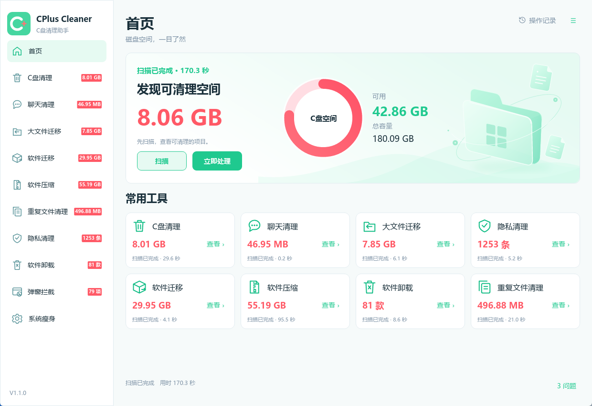

# CPlus Cleaner — Windows 磁盘清理与软件迁移助手

**释放磁盘空间，轻松管理已安装软件。**

[English](README.md) · **简体中文** · [繁體中文](README.zh-TW.md) · [问题反馈](https://github.com/jackqiuai/cplus-cleaner/issues) · [MIT 许可证](LICENSE)

CPlus Cleaner 是免费、绿色免安装的 Windows 桌面工具，集磁盘清理、大文件迁移、软件迁移、透明压缩与隐私清理于一体。本项目使用 **Rust + Iced** 构建，提供简体中文、繁体中文和英文界面。

**绿色免安装，下载后即可运行。** 图片、规则和语言资源均嵌入 EXE。

## 软件截图



## 功能介绍

| 功能 | 说明 |
| --- | --- |
| 首页 | 查看系统盘空间，执行综合扫描，快速进入各项工具。 |
| C盘清理 | 按类别查看临时文件、缓存、日志及系统相关项目，支持全部时间或最近7、30、180天。普通文件按逻辑大小统计；传递优化、Windows更新与旧Windows安装文件的容量由系统清理接口查询。 |
| 聊天清理 | 查找微信、QQ、WhatsApp、Telegram、Discord、Slack、Teams和Signal的受支持缓存、媒体目录，覆盖范围取决于客户端版本和数据布局。 |
| 大文件迁移 | 将大于30 MiB的文件按类型分组，支持展开、选择、删除和迁移；保护规则排除系统组件及字体等文件。 |
| 软件迁移 | 从注册表发现已安装软件，筛选可迁移项目；完整检查后复制到其他NTFS卷，校验内容并通过目录联接保留原安装路径。 |
| 软件压缩 | 调用Windows透明压缩处理符合条件的安装目录，统计真实占用，并保留压缩与还原记录。 |
| 重复文件清理 | 使用SHA-256核验完整内容，每组至少保留一份副本；按类型、重复组和文件逐级展示，支持全部展开与收起。 |
| 隐私清理 | 分类查看受支持的Windows使用痕迹、软件痕迹和浏览器历史记录。 |
| 软件卸载 | 列出注册的软件并调用其卸载程序，卸载后单独查看可处理的残留。 |
| 弹窗拦截 | 根据内置规则发现受支持的软件，提供分组及单条开关、拦截次数和记录。 |
| 系统瘦身 | 提供回收站、休眠、虚拟内存及Windows组件存储相关工具。 |
| 任务栏系统状态 | 在任务栏右侧显示CPU占用率、内存占用率、系统盘空间使用率和上传／下载速度，点击对应项目可打开详情页。 |

设置支持切换语言、自动保存、开机启动、定时清理和关闭时隐藏到托盘。操作记录、各功能记录、反馈、关于与检查更新使用独立窗口。

### 任务栏系统状态

在 **设置 → 系统状态** 中开启后，任务栏右侧会显示紧凑状态栏。CPU、MEM、DISK 显示使用率，**↑ / ↓** 在同一列显示上传和下载速度；DISK 表示系统盘空间使用率。

点击对应项目，可打开 **概览、CPU、内存、磁盘或网络** 详情页。CPU、内存页列出资源占用较高的进程；磁盘页显示系统盘容量与读写活动；网络页显示实时网速、监控期间的流量、接口、当前连接的WLAN名称、连接状态、链路速度、IPv4和IPv6。无法读取的数据显示为 `--`。

网络页采用紧凑布局，无需滚动即可查看信息。关闭详情窗口后监控仍继续运行；关闭设置中的 **系统状态** 开关即可停用。监控只读取系统计数，不保存流量历史记录。

## 下载与运行

项目仓库：[jackqiuai/cplus-cleaner](https://github.com/jackqiuai/cplus-cleaner)。已发布文件请从[Releases](https://github.com/jackqiuai/cplus-cleaner/releases)下载，更新内容与使用说明请查看对应的发布说明。

| 文件 | 使用方式 |
| --- | --- |
| `CPlusCleaner.exe` | 下载后直接运行，无需安装。 |
| `CPlusCleaner-windows-x64.zip` | 解压后运行其中的`CPlusCleaner.exe`。 |
| `SHA256SUMS.txt` | 用于核对EXE或ZIP的SHA-256摘要。 |
| 源码压缩包 | 用于开发；Rust源码根目录包含`Cargo.toml`、`crates/`和`resources/`。 |

本地构建后的程序位于`dist/CPlusCleaner.exe`。重复启动会激活已有窗口。

## 运行要求

- Windows 10/11 x64桌面环境。
- 软件迁移需要适合迁移的源、目标NTFS卷；透明压缩需要NTFS支持。
- 部分受保护目录、卸载程序及系统维护操作需要管理员权限。

## 使用方法

1. 在首页综合扫描，或进入单项功能扫描。
2. 查看分类容量、文件列表、状态说明和已选项目。
3. 选择清理、迁移、压缩或卸载，核对确认内容并查看结果。
4. 需要时通过相应记录页还原受支持的软件迁移或压缩操作。

设置自动保存，选择语言后立即生效。左键点击托盘图标显示主窗口；右键菜单提供清理入口、**设置**和**退出**。

## 清理和迁移前须知

- **删除直接移除文件，不会放入回收站。** 聊天图片、媒体和接收文件可能包含需要保留的数据。
- C盘普通文件统计的是逻辑大小，不保证等于实际释放的磁盘空间；占用中、发生变化或无法访问的文件可能被跳过。
- 清理旧Windows安装文件后，将无法回退到此前的Windows版本。
- 软件迁移排除受保护目录、共享组件、包含系统服务的软件、链接或不支持的目录，以及检测到的环境变量依赖。迁移或还原前请关闭相关软件。
- 压缩可能降低软件启动速度。其他磁盘有空间时，可优先考虑软件迁移；迁移释放源盘空间，但不会减少所有磁盘上的总占用。
- 通过对应记录页还原受支持的软件迁移或压缩。请保留恢复记录和实际软件文件；记录不是内容备份，清空操作记录也不会还原文件。

### 定时清理

程序通过Windows任务计划程序注册`CPlusCleaner-DailyCleanup`。主程序退出后，计划任务仍可按Windows任务条件启动清理；当前配置要求用户处于交互式登录状态。任务重新扫描C盘的全部时间范围，并处理符合条件的默认项目；无人值守选择明确排除旧Windows安装文件和Windows更新清理。请保留任务登记的EXE路径，更换位置后重新配置任务。

## 从源码构建

打开包含`Cargo.toml`的 **Rust源码目录**。安装Rust/rustup、Visual Studio C++ Build Tools及Windows SDK。`rust-toolchain.toml`固定使用 **Rust 1.99.1** 和`x86_64-pc-windows-msvc`目标；保留`Cargo.lock`以固定依赖解析结果。首次构建需要联网下载依赖。

在仓库根目录打开PowerShell：

```powershell
.\build.ps1
```

脚本先运行回归测试，再构建发布版，并在`dist/`生成EXE、便携ZIP和校验文件。仅编译程序时：

```powershell
cargo build --release --locked -p cplus-cleaner
.\target\release\CPlusCleaner.exe
```

开发检查命令：

```powershell
cargo fmt --all --check
cargo clippy --workspace --all-targets --locked -- -D warnings
cargo test --workspace --locked
```

部分Windows测试会在临时目录创建硬链接、目录联接、稀疏或压缩文件，需要相应文件系统权限。代码签名为可选配置，本地编译不会自动获得可信签名，详见[签名配置](docs/CODE_SIGNING.md)。

## 源码结构

| 路径 | 用途 |
| --- | --- |
| `crates/desktop` | Iced界面、语言、窗口及托盘集成 |
| `crates/core` | 功能引擎、清理规则、操作校验、设置及记录 |
| `crates/platform_windows` | Windows文件系统、注册表、进程及Shell API |
| `resources` | 内嵌图片、规则和语言文件，参见[资源说明](resources/assets/README.md) |
| `docs` | [迁移说明](docs/MIGRATION.md)、[验证记录](docs/VALIDATION.md)及签名资料 |
| `build.ps1` / `package.ps1` | 本地构建与打包 |
| `.github/workflows` | Windows构建、可选签名与发布附件流程 |

完整的[目录与文件用途说明](docs/SOURCE_MAP.md) · [干净克隆构建与自动发布说明](docs/BUILDING.md)。

## 语言与本地数据

在设置中选择 **简体中文 / 繁體中文 / English**。首次启动按Windows语言偏好选择界面语言。设置、操作记录及恢复资料保存在：

```text
%LOCALAPPDATA%\CPLUSCLEANER\
```

使用独立的开发配置目录：

```powershell
.\dist\CPlusCleaner.exe --preview --language zh --data-dir D:\CPlusCleaner-TestData
```

预览模式隔离设置，停用开机启动/定时任务注册、弹窗拦截后台线程和系统维护操作。**它不是文件系统沙箱**，文件操作仍应使用可丢弃的测试数据。

## 常见问题

<details>
<summary>软件迁移后，为什么原安装目录还在？</summary>

原路径是指向目标位置的Windows目录联接。请保留目标软件目录，并通过迁移记录执行受支持的还原。
</details>

<details>
<summary>为什么有的软件不在迁移或压缩列表中？</summary>

这两项功能以注册软件为发现来源，并进行适用性与保护检查。不支持的目录、链接、系统组件、运行状态或权限问题都可能使项目被过滤或暂不可操作。
</details>

<details>
<summary>点击关闭后，为什么程序仍在运行？</summary>

启用关闭时隐藏到托盘后，关闭主窗口会隐藏界面。完成当前操作后，可从托盘菜单选择退出，完全结束程序。
</details>

## 更新或移除

通过 **≡ → 检查更新** 查询GitHub上的更新信息。下载与替换EXE仍需手动完成，请先阅读对应的发布说明。替换前完全退出旧程序，保留恢复资料；需要更换EXE路径时，先关闭开机启动与定时清理，再在新位置重新配置。设置自动保存。

移除便携程序前，关闭开机启动和定时清理，等待操作结束并从托盘退出。删除程序自身文件即可；如需后续还原，请继续保留`%LOCALAPPDATA%\CPLUSCLEANER\`和迁移后的实际软件目录。删除清理工具不会撤销迁移或压缩，也不会恢复已删除文件。

## 反馈与支持

通过[GitHub Issues](https://github.com/jackqiuai/cplus-cleaner/issues)提交问题或建议，附上Windows版本和复现步骤；截图及日志请遮挡个人路径与账号信息。问题反馈窗口可复制环境信息并打开提交页面，是否发送由你决定。

你可以在软件中打开**捐赠**、访问[Buy me a coffee](https://ko-fi.com/qiujack)，或给[项目仓库](https://github.com/jackqiuai/cplus-cleaner)点星，支持持续维护。

## 许可证

项目原创代码采用[MIT许可证](LICENSE)。第三方图片及规则数据保留各自的权利与分发条件，本项目许可证不会将这些材料重新授权为MIT。项目独立于本文提及的软件厂商。
