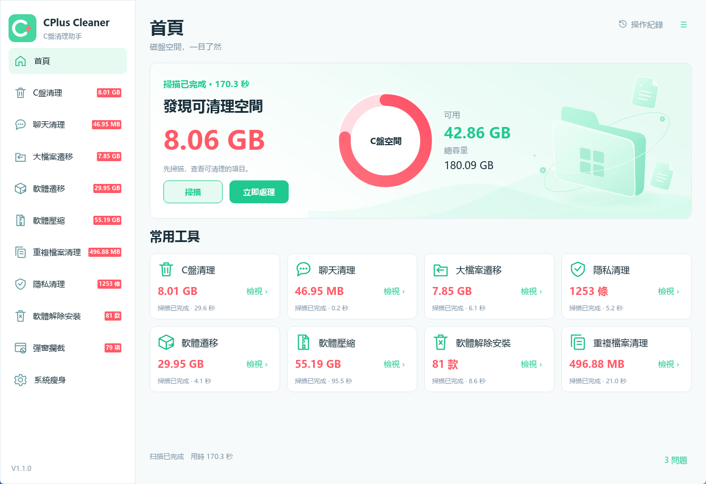

# CPlus Cleaner — Windows 磁碟清理與軟體遷移助手

**釋放磁碟空間，輕鬆管理已安裝軟體。**

[English](README.md) · [简体中文](README.zh-CN.md) · **繁體中文** · [問題回報](https://github.com/jackqiuai/cplus-cleaner/issues) · [MIT 許可證](LICENSE)

CPlus Cleaner 是免費、免安裝的 Windows 桌面工具，集磁碟清理、大檔案遷移、軟體遷移、透明壓縮與隱私清理於一體。本專案使用 **Rust + Iced** 建置，提供簡體中文、繁體中文和英文介面。

**免安裝，下載後即可執行。** 圖片、規則和語言資源均嵌入 EXE。

## 軟體截圖



## 功能介紹

| 功能 | 說明 |
| --- | --- |
| 首頁 | 查看系統碟空間，執行綜合掃描，快速進入各項工具。 |
| C盤清理 | 按類別查看臨時檔案、快取、日誌及系統相關項目，支援全部時間或最近7、30、180天。一般檔案按邏輯大小統計；傳遞優化、Windows更新與舊Windows安裝檔案的容量由系統清理介面查詢。 |
| 聊天清理 | 查找微信、QQ、WhatsApp、Telegram、Discord、Slack、Teams和Signal的支援的快取、媒體目錄，覆蓋範圍取決於用戶端版本和資料配置。 |
| 大檔案遷移 | 將大於30 MiB的檔案按類型分組，支援展開、選擇、刪除和遷移；保護規則排除系統元件及字型等檔案。 |
| 軟體遷移 | 從登錄檔發現已安裝軟體，篩選可遷移項目；完整檢查後複製到其他NTFS卷，校驗內容並通過目錄聯結保留原安裝路徑。 |
| 軟體壓縮 | 呼叫Windows透明壓縮處理符合條件的安裝目錄，統計真實佔用，並保留壓縮與還原記錄。 |
| 重複檔案清理 | 使用SHA-256核驗完整內容，每組至少保留一份副本；按類型、重複組和檔案逐級展示，支援全部展開與收起。 |
| 隱私清理 | 分類查看受支援的Windows使用痕跡、軟體痕跡和瀏覽器歷史記錄。 |
| 軟體卸載 | 列出註冊的軟體並呼叫其卸載程式，卸載後單獨查看可處理的殘留。 |
| 彈窗攔截 | 根據內建規則發現受支援的軟體，提供分組及單條開關、攔截次數和記錄。 |
| 系統瘦身 | 提供資源回收筒、休眠、虛擬記憶體及Windows元件儲存相關工具。 |

設定支援切換語言、自動儲存、開機啟動、定時清理和關閉時隱藏到系統匣。操作記錄、各功能記錄、回饋、關於與檢查更新使用獨立視窗。

## 下載與執行

專案儲存庫：[jackqiuai/cplus-cleaner](https://github.com/jackqiuai/cplus-cleaner)。已發布檔案請從[Releases](https://github.com/jackqiuai/cplus-cleaner/releases)下載，更新內容與使用說明請查看對應的發布說明。

| 檔案 | 使用方式 |
| --- | --- |
| `CPlusCleaner.exe` | 下載後直接執行，無需安裝。 |
| `CPlusCleaner-windows-x64.zip` | 解壓後執行其中的`CPlusCleaner.exe`。 |
| `SHA256SUMS.txt` | 用於核對EXE或ZIP的SHA-256摘要。 |
| 原始碼壓縮包 | 用於開發；Rust原始碼根目錄包含`Cargo.toml`、`crates/`和`resources/`。 |

本地建置後的程式位於`dist/CPlusCleaner.exe`。重複啟動會顯示既有視窗。

## 執行要求

- Windows 10/11 x64桌面環境。
- 軟體遷移需要適合遷移的源、目標NTFS卷；透明壓縮需要NTFS支援。
- 部分受保護目錄、卸載程式及系統維護操作需要管理員權限。

## 使用方法

1. 在首頁綜合掃描，或進入單項功能掃描。
2. 查看分類容量、檔案列表、狀態說明和已選項目。
3. 選擇清理、遷移、壓縮或卸載，核對確認內容並查看結果。
4. 需要時通過相應記錄頁還原受支援的軟體遷移或壓縮操作。

設定自動儲存，選擇語言後立即生效。左鍵點擊系統匣圖標顯示主視窗；右鍵選單提供清理入口、**設定**和**結束**。

## 清理和遷移前須知

- **刪除直接移除檔案，不會放入資源回收筒。** 聊天圖片、媒體和接收檔案可能包含需要保留的資料。
- C盤一般檔案統計的是邏輯大小，不保證等於實際釋放的磁碟空間；佔用中、發生變化或無法訪問的檔案可能被跳過。
- 清理舊Windows安裝檔案後，將無法回退到此前的Windows版本。
- 軟體遷移排除受保護目錄、共享元件、包含系統服務的軟體、連結或不支援的目錄，以及檢測到的環境變量相依套件。遷移或還原前請關閉相關軟體。
- 壓縮可能降低軟體啟動速度。其他磁碟有空間時，可優先考慮軟體遷移；遷移釋放來源磁碟空間，但不會減少所有磁碟上的總佔用。
- 通過對應記錄頁還原受支援的軟體遷移或壓縮。請保留復原記錄和實際軟體檔案；記錄不是內容備份，清空操作記錄也不會還原檔案。

### 定時清理

程式通過Windows工作排程器註冊`CPlusCleaner-DailyCleanup`。主程式結束後，排程工作仍可按Windows工作條件啟動清理；目前配置要求使用者處於互動式登入狀態。工作重新掃描C盤的全部時間範圍，並處理符合條件的預設項目；無人值守選擇明確排除舊Windows安裝檔案和Windows更新清理。請保留工作登記的EXE路徑，更換位置後重新配置工作。

## 從原始碼建置

開啟包含`Cargo.toml`的 **Rust原始碼目錄**。安裝Rust/rustup、Visual Studio C++ Build Tools及Windows SDK。`rust-toolchain.toml`固定使用 **Rust 1.99.1** 和`x86_64-pc-windows-msvc`目標；保留`Cargo.lock`以固定相依套件解析結果。第一次建置需要聯網下載相依套件。

在儲存庫根目錄打開PowerShell：

```powershell
.\build.ps1
```

腳本先執行回歸測試，再建置發布版，並在`dist/`生成EXE、便攜ZIP和校驗檔案。僅編譯程式時：

```powershell
cargo build --release --locked -p cplus-cleaner
.\target\release\CPlusCleaner.exe
```

開發檢查指令：

```powershell
cargo fmt --all --check
cargo clippy --workspace --all-targets --locked -- -D warnings
cargo test --workspace --locked
```

部分Windows測試會在臨時目錄建立硬連結、目錄聯結、稀疏或壓縮檔案，需要相應檔案系統權限。程式碼簽名為可選配置，本地編譯不會自動獲得可信簽名，詳見[簽名配置](docs/CODE_SIGNING.md)。

## 原始碼結構

| 路徑 | 用途 |
| --- | --- |
| `crates/desktop` | Iced介面、語言、視窗及系統匣集成 |
| `crates/core` | 功能引擎、清理規則、操作校驗、設定及記錄 |
| `crates/platform_windows` | Windows檔案系統、登錄檔、進程及Shell API |
| `resources` | 內嵌圖片、規則和語言檔案，參見[資源說明](resources/assets/README.md) |
| `docs` | [遷移說明](docs/MIGRATION.md)、[驗證記錄](docs/VALIDATION.md)及簽名資料 |
| `build.ps1` / `package.ps1` | 本地建置與打包 |
| `.github/workflows` | Windows建置、可選簽名與發布附件流程 |

## 語言與本地資料

在設定中選擇 **簡體中文 / 繁體中文 / English**。第一次啟動按Windows語言偏好選擇介面語言。設定、操作記錄及復原資料儲存在：

```text
%LOCALAPPDATA%\CPLUSCLEANER\
```

使用獨立的開發配置目錄：

```powershell
.\dist\CPlusCleaner.exe --preview --language zh-TW --data-dir D:\CPlusCleaner-TestData
```

預覽模式隔離設定，停用開機啟動/定時工作註冊、彈窗攔截後臺線程和系統維護操作。**它不是檔案系統沙箱**，檔案操作仍應使用可丟棄的測試資料。

## 常見問題

<details>
<summary>軟體遷移後，為什么原安裝目錄還在？</summary>

原路徑是指向目標位置的Windows目錄聯結。請保留目標軟體目錄，並通過遷移記錄執行受支援的還原。
</details>

<details>
<summary>為什么有的軟體不在遷移或壓縮列表中？</summary>

這兩項功能以註冊軟體為發現來源，並進行適用性與保護檢查。不支援的目錄、連結、系統元件、執行狀態或權限問題都可能使項目被過濾或暫不可操作。
</details>

<details>
<summary>點擊關閉後，為什么程式仍在執行？</summary>

啟用關閉時隱藏到系統匣後，關閉主視窗會隱藏介面。完成目前操作後，可從系統匣選單選擇結束，完全結束程式。
</details>

## 更新或移除

通過 **≡ → 檢查更新** 查詢GitHub上的更新資訊。下載與替換EXE仍需手動完成，請先閱讀對應的發布說明。替換前完全結束舊程式，保留復原資料；需要更換EXE路徑時，先關閉開機啟動與定時清理，再在新位置重新配置。設定自動儲存。

移除便攜程式前，關閉開機啟動和定時清理，等待操作結束並從系統匣結束。刪除程式自身檔案即可；如需後續還原，請繼續保留`%LOCALAPPDATA%\CPLUSCLEANER\`和遷移後的實際軟體目錄。移除清理工具不會撤銷遷移或壓縮，也不會復原已刪除檔案。

## 回饋與支援

通過[GitHub Issues](https://github.com/jackqiuai/cplus-cleaner/issues)提交問題或建議，附上Windows版本和復現步驟；截圖及日誌請遮擋個人路徑與帳號信息。問題回報視窗可複製環境信息並打開提交頁面，是否發送由你決定。

你可以在軟體中打開**捐贈**、訪問[Buy me a coffee](https://ko-fi.com/qiujack)，或給[專案儲存庫](https://github.com/jackqiuai/cplus-cleaner)點星，支援持續維護。

## 許可證

專案原創程式碼采用[MIT許可證](LICENSE)。第三方圖片及規則資料保留各自的權利與分發條件，本專案許可證不會將這些材料重新授權為MIT。專案獨立於本文提及的軟體廠商。

完整的[目錄與檔案用途說明](docs/SOURCE_MAP.md) · [乾淨複製建置與自動發佈說明](docs/BUILDING.md)。
